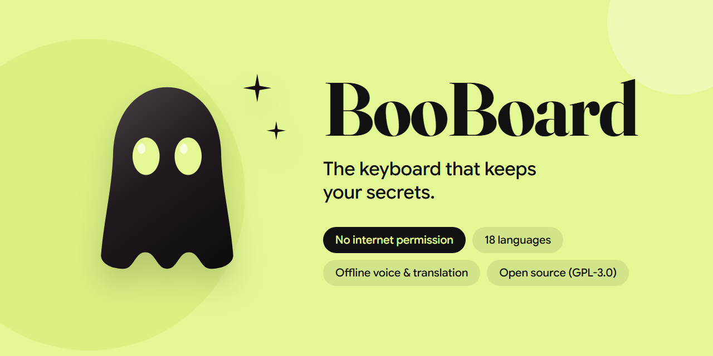
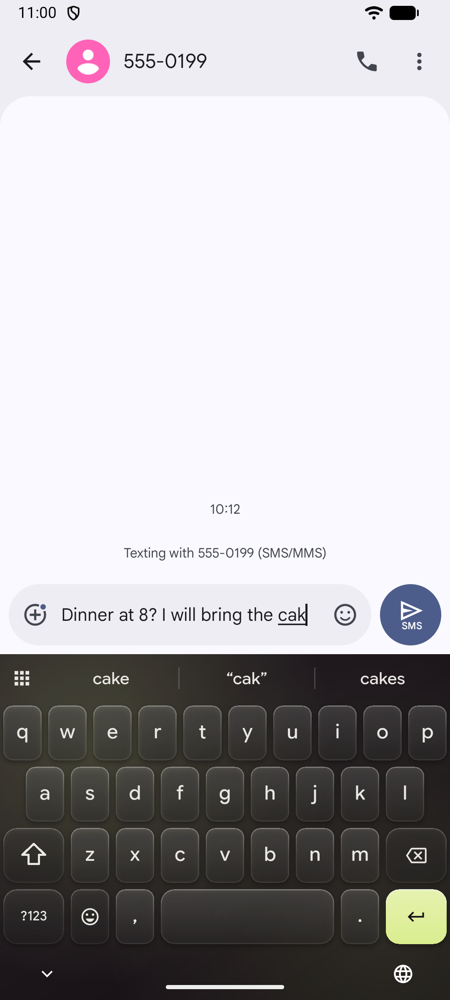
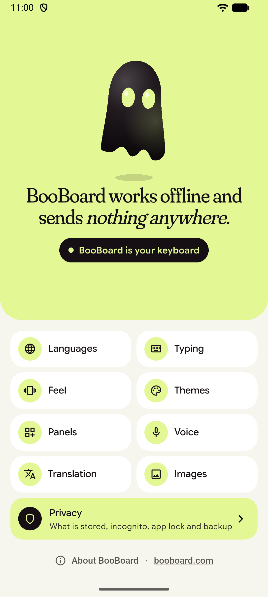
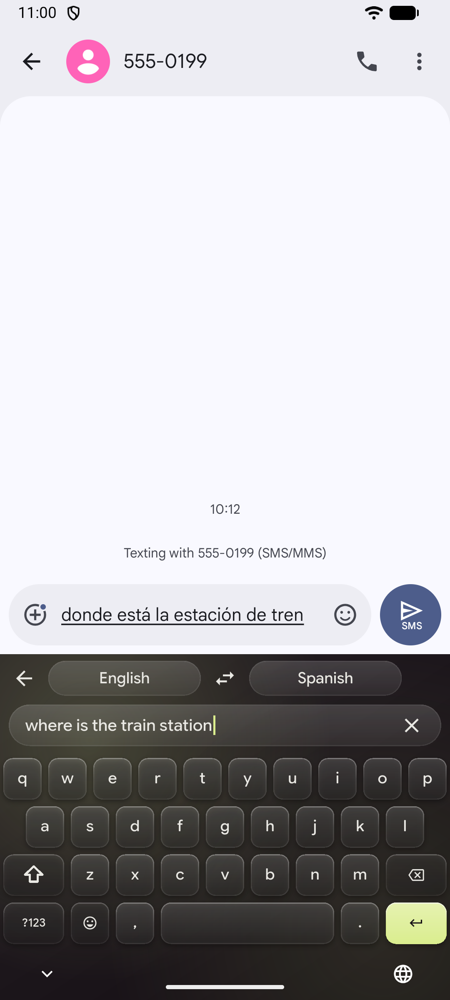
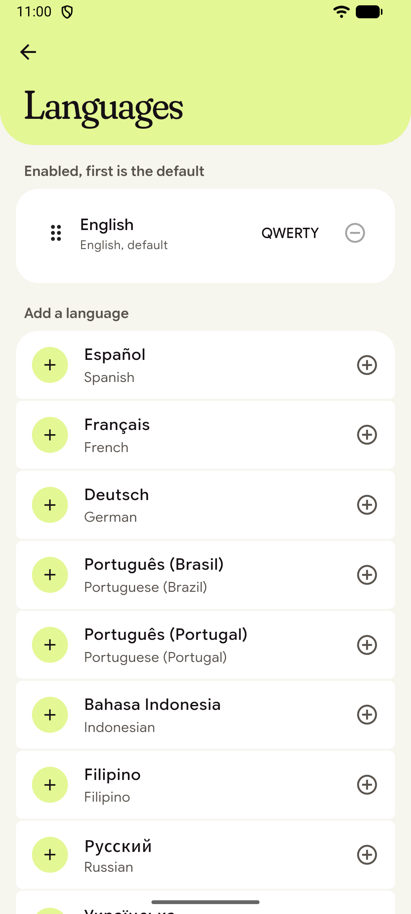
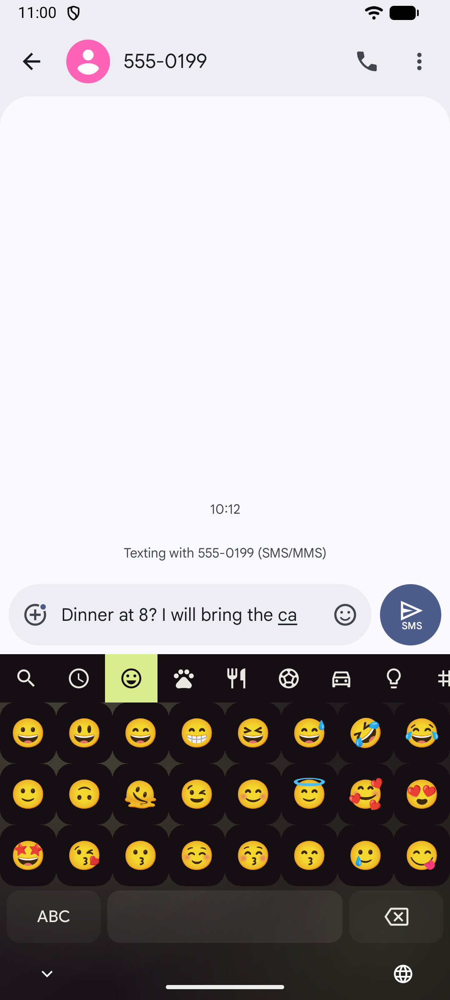
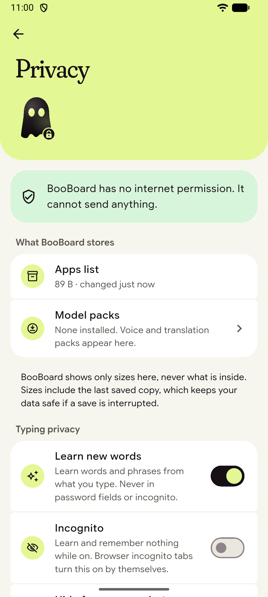
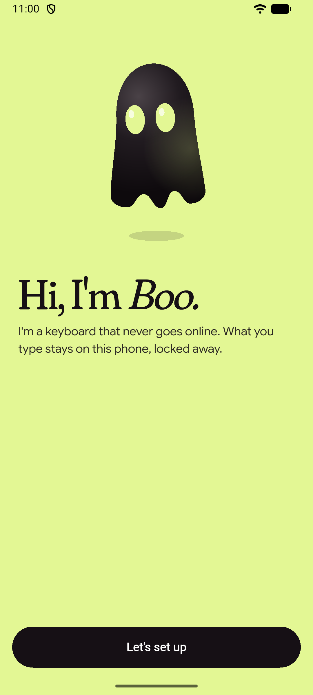
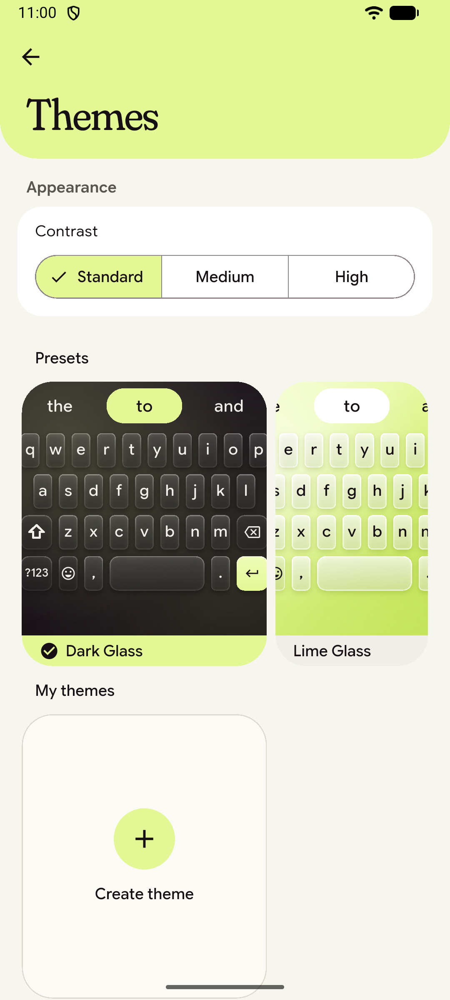

<p align="center">
  
</p>

<h3 align="center">A private keyboard for Android that works fully offline.<br>It has no internet permission, so it has no way to tell anyone what you type.</h3>

<p align="center">
  <a href="https://github.com/knandu18/booboard/releases/latest/download/app-arm64-v8a-foss-release.apk"></a>
  <a href="https://booboard.com"></a>
  <a href="LICENSE"></a>
  
</p>

<br>

<table align="center">
  <tr>
    <td align="center" width="25%"><br><sub>Dark Glass keyboard</sub></td>
    <td align="center" width="25%"><br><sub>The app</sub></td>
    <td align="center" width="25%"><br><sub>Translate as you type</sub></td>
    <td align="center" width="25%"><br><sub>18 languages</sub></td>
  </tr>
  <tr>
    <td align="center" width="25%"><br><sub>Emoji with search</sub></td>
    <td align="center" width="25%"><br><sub>Privacy centre</sub></td>
    <td align="center" width="25%"><br><sub>Easy setup, with Boo</sub></td>
    <td align="center" width="25%"><br><sub>Lime Glass theme</sub></td>
  </tr>
</table>

## Why BooBoard

Every keyboard sees your passwords, your messages and your searches. Android even warns you about that when you turn a
new one on. BooBoard is built so you do not have to take anyone's word for it.

- **No internet permission.** The release app cannot connect to the internet at all. CI fails the build if a network
  permission ever appears. Links you tap open in your browser.
- **Nothing leaves your phone.** Predictions, swipe typing, voice typing and translation all run on the device. No
  accounts, no analytics, no ads, no crash reporting.
- **What it learns stays encrypted.** Learned words and clipboard history are encrypted with a key held in Android
  Keystore. They are never synced, and never learned in password fields or in incognito.
- **Models are data packs you choose.** Voice and translation models are signed files. You download them in your own
  browser and import them. A pack holds data only, never code, and is checked on your phone before it is installed.
- **Tools to stay private.** App lock with fingerprint or PIN, hide from screenshots, incognito (also per app), and a
  privacy centre that shows how much is stored, never what.
- **Open source.** GPL-3.0-or-later. Read it, build it, check it.

## What it does

### Typing

- **18 languages**: English, Spanish, French, German, Portuguese (Brazil and Portugal), Indonesian, Filipino, Hindi
  (Devanagari, InScript, or English letters), Marathi, Bengali, Tamil, Telugu, Arabic, Urdu, Russian, Ukrainian,
  Chinese (pinyin) and Japanese (12-key flick or romaji). Turn on several at once.
- Autocorrect, next-word prediction and swipe typing.
- Emoji panel with search.
- Clipboard history with pins, a text-editing pad, and personal shortcuts ("omw").
- One-handed and floating modes, adjustable height, haptics and sounds.

### Offline extras

- **Voice typing in English**, on your phone, using a voice pack. Audio stays in memory and is never saved.
- **Translator** that types the translation straight into the app. The English → Spanish pack is out now;
  packs for more languages are coming, and any two languages with packs work together through English.
- **Chinese and Japanese dictionaries** as packs.

Images (making pictures offline, on your phone) is coming soon. It is not part of this release.

### Look

- **Dark Glass** is the default theme. **Lime Glass** is the bright one.
- Frosted glass keys drawn inside the keyboard, so it looks the same on every phone.

### Privacy tools

- App lock, hide from screenshots, incognito (also per app).
- Privacy centre: see how much is stored and wipe it, all or by category.
- Encrypted backup file that you make yourself, protected by your own passphrase.

## Install

1. On your phone, tap **Download APK** above. Most phones need the `arm64-v8a` file. The `x86_64` and `armeabi-v7a`
   files are on the [releases page](https://github.com/knandu18/booboard/releases).
2. Open the file and allow the install.
3. Open BooBoard. The setup turns the keyboard on in *Settings*, picks your languages and lets you try it.
4. Want voice, translation or the Chinese and Japanese dictionaries? Get the packs from the releases page. In
   BooBoard, open *Settings → Voice → Model packs* (or tap **Get** in the keyboard): **Download** opens the pack in your
   browser, **Import** installs the file.

To check a download, compare it with `SHA256SUMS.txt` on the release page:

```
sha256sum app-arm64-v8a-foss-release.apk
```

## Build from source

The Flutter version is pinned in `tool/release/flutter-version.txt`.

```powershell
flutter pub get
flutter test
flutter build apk --release --flavor foss --split-per-abi
```

Builds need a flavour: `foss` (GitHub and F-Droid) or `play` (Google Play). Without the release keys, release builds
are signed with the debug key and are for testing only. The release steps are in
[docs/release/RELEASING.md](docs/release/RELEASING.md).

For development on an emulator:

```powershell
flutter build apk --debug --flavor foss
. .\tool\adb_ime.ps1; Install-BooBoard; Enable-BooBoard; Open-Testbed -Field text
```

Regenerate the platform contract after editing `pigeons/messages.dart`:

```powershell
dart run pigeon --input pigeons/messages.dart
```

The upcoming Images engine uses a submodule. The default release build does not need it:

```
git submodule update --init third_party/stable-diffusion.cpp
cd third_party/stable-diffusion.cpp
git submodule update --init ggml
```

### How it is built

```
BooBoardImeService (Kotlin, thin)  --Pigeon-->  keyboardMain()  (Dart: keyboard UI + language engines)
SettingsActivity (Kotlin)            --Pigeon-->  main()          (Dart: settings app)
```

The keyboard UI and every language engine are Dart. Kotlin only hosts the Flutter engine, talks to Android's
InputConnection and Keystore, and keeps a native fallback so you can always switch keyboards.

### Rules for contributors

- `tool/check_release_permissions.sh build/app/outputs/flutter-apk/*-release.apk` must pass (no network permissions).
- Never log typed text. Use `BooBoardLog` with events, sizes and timings only.
- No dependency may contain network, analytics or Google Play Services code.

## More

- [Privacy policy](docs/release/privacy-policy.md)
- [License](LICENSE): GPL-3.0-or-later. Third-party notices are in [THIRD_PARTY_NOTICES.md](THIRD_PARTY_NOTICES.md).
- Website: [booboard.com](https://booboard.com)
- Report a problem: [GitHub issues](https://github.com/knandu18/booboard/issues)
